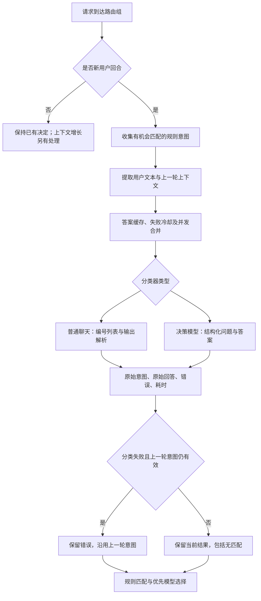

# Magpie 原生意图识别：固定源码阅读报告

日期：2026-11-03。仓库：<https://github.com/yetone/magpie>。固定提交：`6a6e4fefac9261db4e1eeb769665a21ebaefbd12`。

本报告依据 `research/sources/` 下的六个固定文件，完整文件路径和 SHA-256 见 `research/source-lock.json`。这是静态代码研究，没有运行 Magpie 或调用真实模型。下面的路径均相对上游仓库，行号对应本地固定快照，不对应变化中的 main。

## 主流程

## 证据表

| 行为 | 源码位置 | 对实验的影响 |
|---|---|---|
| 每个用户回合判断；工具往返保持决定 | `internal/gateway/rules.go:191`，回合判定分支 | 分类调用次数不等于所有网关请求次数 |
| 仅在候选规则需要意图或需要自动 effort 时询问 | `rules.go:296` 起 | 不应假设每次请求都必然分类 |
| 当前用户文本超过 4000 个 Unicode 字符时保留头 3000、尾 1000 | `classify.go:258`、`:279` | 不是 4000 tokens；需单测长输入 |
| 前轮用户、助手文字有单独的截断和提取逻辑 | `classify.go:290`、`:300` | 原生实现已包含前文，不能按旧网页说明假定单轮 |
| 缓存 10 分钟、错误冷却 30 秒、重复并发请求合并 | `classify.go:36`、`:146` | 性能实验区分缓存与真实分类耗时 |
| 缓存键包含模型、意图、前轮标签/effort/文本、当前文本 | `classify.go:148` | 同一句“继续”可能因前文不同产生不同缓存项 |
| 聊天分类固定系统提示，用户消息列编号 | `classify.go:331`、`:344` | 原生模板作为独立基线保留 |
| 非流式、temperature 0、max_tokens 2048 | `classify.go:359` 起 | 后续优化不能静默替代原生配置 |
| 用 `[0-9]+` 对应的第一段数字解析，0 为无匹配 | `classify.go:392`、`:397` | “I choose 2”、甚至“-2”会被解析为 2；格式遵从率单列 |
| 分类器按 provider 能力选择聊天或决策模型路径 | `classify.go:507` | Jev 不走普通文字编号解析 |
| 聊天模型的 intent 和 effort 可以分别并发询问 | `classify.go:519` 起 | “每回合一次”不代表任何配置下只有一个上游请求 |
| Jev 请求含 state、Choice 意图和可选 Score effort | `decide.go:129`、`:177` | 不只是在同一聊天提示里换模型 |
| Jev 接受意图的置信门限为 0.4；优先从概率重新计算尺度 | `decide.go:36`、`:46`、`:238` | 0.4 不是最高类别概率的直接门限 |
| 类别与等级采用不同的无匹配和低置信处理 | `decide.go:238` 起 | 本研究主任务先用任务类型，不混入难度标签 |
| 分类出错且前轮意图仍属于当前候选，则沿用并记录 fallback | `rules.go:341`–`:355` | 原始错误保留，回退不能计入原始分类正确数 |
| 默认等待 8 秒，可配置；嵌套路由组共享等待预算 | `docs/subsystems/gateway-routing.md:168` | 超时测试需记录全局预算，不逐层重复相加 |

## 实验定义与原生行为的差异

研究中的 `other` 是明确语义类别；Magpie 的编号 0 则是没有匹配意图，两者不自动等同。原生模板基线使用五个业务类别，0 映射为研究标签 other；显式六分类模板作为独立配置。Jev 的 `none of these` 同样需要明确映射，低置信拒绝不能直接当成正确 other。

本阶段 `native.py` 仅摘录数字解析、字符截断和前轮回退三项规则。尚未实现完整的消息清理、缓存、规则条件、路由保持或 Jev 概率尺度，不得称为完整原生复现。尚未下载的 provider 辅助实现需要继续跟踪核验，不凭注释推断全部细节。

## 待验证假设

- 类别固定且有标注时，BERT 分类头值得作为低生成开销基线；收益尚无实测。
- “继续”等短消息需上下文；用单轮数据评价全部方法会偏离实际工作方式。
- 错误后的上一轮回退可能提高系统可用性，也可能在任务切换时掩盖错误。
- 原生数字解析宽松，不能用解析成功率替代分类准确率或格式遵从率。
